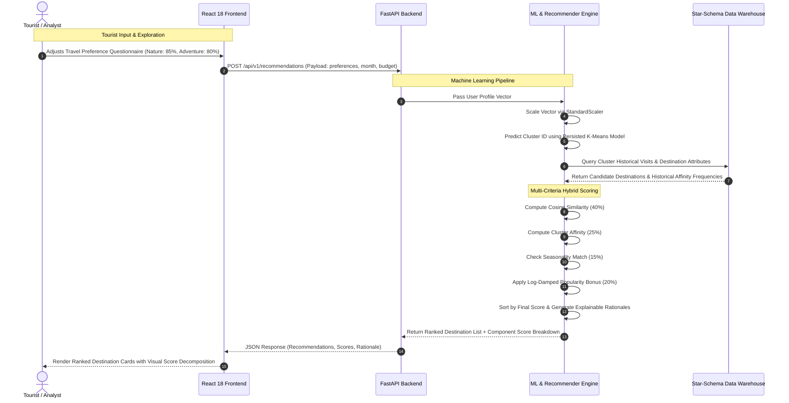
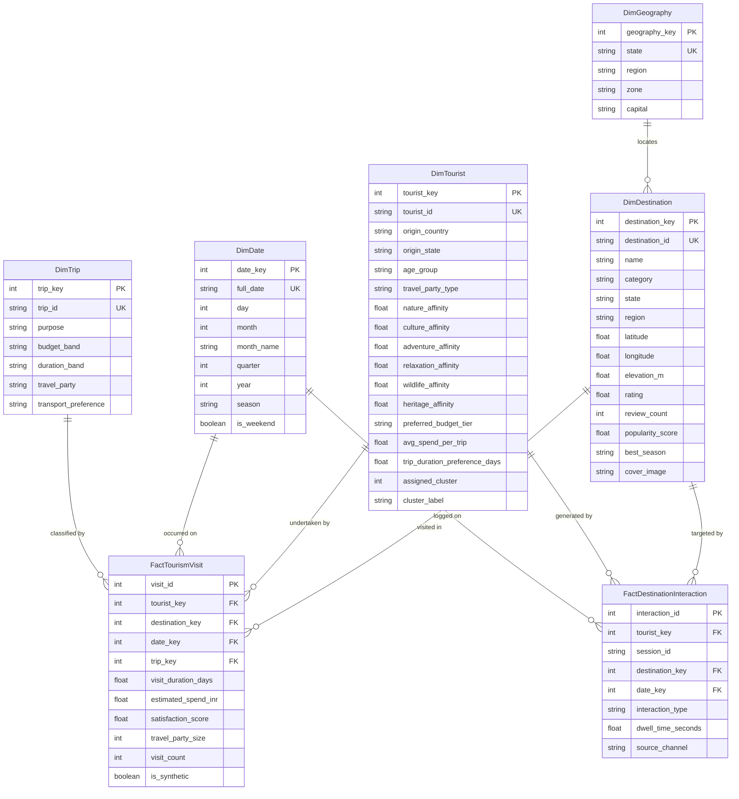

# PROJECT REPORT: TOURISM INTELLIGENCE INDIA
## Tourism Data Warehouse for Tourist Behaviour Mining and Destination Recommendation

---

**Project Title:** Tourism Intelligence India: A Dimensional Tourism Data Warehouse for Tourist Behaviour Mining, Geospatial 3D Exploration, and Multi-Criteria Destination Recommendation  
**Academic Domain:** Computer Science & Engineering / Data Science / Geospatial Information Systems  
**Core Methodology:** Ralph Kimball Dimensional Modeling (Star Schema), Unsupervised Machine Learning (K-Means Clustering & Silhouette Score Optimization), Hybrid Content-Cluster-Seasonal Recommendation Engine, Haversine Geodesic Spatial Analytics, and Agentic AI Assistance.  
**Platform Stack:** Python 3.12, FastAPI, SQLAlchemy 2.0, PostgreSQL/PostGIS & SQLite3, Scikit-learn, React 18, TypeScript, Vite, MapLibre GL JS (3D Terrain), Recharts, and Tailwind CSS.  
**Version:** 1.0.0 Production Portfolio Release  
**Date of Submission:** October 2026  

---

## TABLE OF CONTENTS

1. **Executive Summary & Abstract**
2. **Chapter 1: Introduction & Problem Definition**
   - 1.1 Background & Domain Context
   - 1.2 Industry Challenges & Problem Statement
   - 1.3 Project Objectives
   - 1.4 Scope & Boundary Conditions
3. **Chapter 2: Literature Review & Theoretical Foundation**
   - 2.1 Evolution of Tourism Information Systems (TIS)
   - 2.2 Data Warehousing Paradigms: Kimball Star-Schema vs. Inmon CIF
   - 2.3 Unsupervised Data Mining & Tourist Segmentation
   - 2.4 Recommendation Engine Paradigms (Collaborative vs. Content vs. Hybrid)
   - 2.5 Modern Geospatial 3D Terrain Visualization (DEM / Hillshading)
4. **Chapter 3: Software Requirements & Technical Specifications (SRS)**
   - 3.1 Functional Requirements (FR)
   - 3.2 Non-Functional Requirements (NFR)
   - 3.3 Hardware, Runtime, and Operating Environment Specifications
   - 3.4 Technology Stack Selection & Justification Matrix
5. **Chapter 4: System Architecture & Component Interaction**
   - 4.1 High-Level Architectural Topology
   - 4.2 Data Flow & Component Interaction Model
   - 4.3 Request-Response Lifecycle
6. **Chapter 5: Tourism Data Warehouse (DWH) Modeling & Schema Design**
   - 5.1 Grain Definition
   - 5.2 Star-Schema Entity-Relationship Model
   - 5.3 Fact Tables Specifications (`FactTourismVisit`, `FactDestinationInteraction`)
   - 5.4 Dimension Tables Specifications (`DimDestination`, `DimTourist`, `DimDate`, `DimTrip`, `DimGeography`)
   - 5.5 Indexing Strategy, Surrogate Keys, and Integrity Constraints
   - 5.6 Online Analytical Processing (OLAP) Engine & Multi-Dimensional Cube Operations
7. **Chapter 6: Datasets & Automated ETL Pipeline**
   - 6.1 Data Acquisition & Source Provenance (OSM, Wikimedia, ASI, Ministry of Tourism)
   - 6.2 Raw Data Ingestion Schema
   - 6.3 The 6-Stage ETL Engine (Extract, Validate, Clean, Transform, Load, Audit)
   - 6.4 Data Quality Assurance, Bounding-Box Validation, and Deduplication
   - 6.5 Synthetic Academic Benchmarking vs. Real Factual Records
8. **Chapter 7: Tourist Behaviour Mining & Machine Learning**
   - 7.1 Feature Engineering & Vector Space Representation
   - 7.2 Normalization & Standardization Formulations
   - 7.3 Unsupervised K-Means Clustering Algorithm & K-Means++ Seeding
   - 7.4 Hyperparameter Tuning & Model Selection across $k \in [2, 7]$
   - 7.5 Mathematical Evaluation: Inertia (Elbow Method) and Silhouette Coefficient
   - 7.6 Empirical Persona Derivation from Unscaled Cluster Centroids
   - 7.7 Model Serialization, Versioning, and Real-Time Inference
9. **Chapter 8: Multi-Criteria Hybrid Recommendation Engine**
   - 8.1 Algorithmic Formulation & Composite Scoring Model
   - 8.2 Component 1: Content-Based Cosine Similarity Vector Matching ($w_1 = 0.40$)
   - 8.3 Component 2: Cluster-Level Behavioral Affinity ($w_2 = 0.25$)
   - 8.4 Component 3: Dynamic Seasonality Alignment ($w_3 = 0.15$)
   - 8.5 Component 4: Logarithmic Popularity Bias Dampening ($w_4 = 0.20$)
   - 8.6 Cold-Start Mitigation & Explainable AI (XAI) Recommendation Rationales
10. **Chapter 9: Geospatial 3D Explorer & UI/UX Design System**
    - 9.1 Design Philosophy: Dark Navy, Deep Teal, and Mountain Emerald Aesthetics
    - 9.2 MapLibre GL 3D Terrain, Digital Elevation Models (DEM), and Pitch Camera Controls
    - 9.3 Great-Circle Haversine Geodesic Proximity Engine
    - 9.4 Topological Fallback Architecture
    - 9.5 Detailed Module Breakdown (Home, 3D Explorer, Directory, Detail, Recommendations, Analytics, Assistant)
11. **Chapter 10: Controlled Agentic AI Travel Assistant**
    - 10.1 Deterministic Tool Interface Architecture
    - 10.2 Retrieval-Augmented Generation (RAG) over Verified Tourism Facts
    - 10.3 Structured Itinerary Synthesis Engine
    - 10.4 Safety Fallback Mechanisms & Zero-Hallucination Guarantees
12. **Chapter 11: Verification, Automated Testing & Experimental Results**
    - 11.1 Test Strategy & Test Suite Architecture
    - 11.2 Automated Pytest Unit & Integration Test Results (13/13 Passed)
    - 11.3 Frontend Production Bundle Compilation & Tree-Shaking Analysis
    - 11.4 Machine Learning Empirical Evaluation Results
13. **Chapter 12: Deployment, Operations & User Guide**
    - 12.1 Local Development Setup & Execution Steps
    - 12.2 Docker & Containerized Orchestration (`docker-compose.yml`)
    - 12.3 API Documentation Guide (Swagger UI & ReDoc)
14. **Chapter 13: Project Limitations & Future Enhancements**
    - 13.1 Current System Limitations
    - 13.2 Roadmap for Future Research & Commercial Extensions
15. **Chapter 14: Conclusion**
16. **References & Bibliography**

---

# EXECUTIVE SUMMARY & ABSTRACT

Tourism is one of the primary drivers of socioeconomic development, cultural preservation, and national revenue for India, contributing significantly to national GDP and employment. However, the Indian tourism ecosystem faces significant technological challenges: fragmented destination datasets, lack of unified historical interaction analytics, absence of dimensional data warehousing standards, generic recommendation mechanisms that suffer from severe popularity bias, and flat, static user interfaces that fail to capture the topographic grandeur of the subcontinent.

This project, titled **Tourism Intelligence India**, presents the design, mathematical formulation, full-stack implementation, and empirical evaluation of an enterprise-grade platform addressing these deficiencies. 

The system is constructed upon five foundational pillars:
1. **A Ralph Kimball Dimensional Star-Schema Data Warehouse**: Structured with conformed dimensions (`DimDestination`, `DimTourist`, `DimDate`, `DimTrip`, `DimGeography`) and granular fact tables (`FactTourismVisit`, `FactDestinationInteraction`) containing audited historical and academic benchmark visit telemetry.
2. **An Automated 6-Stage ETL Engine**: Extracting, validating, cleansing, transforming, loading, and auditing multi-source destination records, enforcing geographic bounding-box constraints (India Lat $6^\circ - 38^\circ\text{N}$, Lon $68^\circ - 98^\circ\text{E}$), category ontology mapping, and duplicate scrubbing.
3. **Tourist Behaviour Mining**: An unsupervised machine learning pipeline utilizing standardized 8-dimensional tourist affinity vectors, K-Means++ clustering, and dual hyperparameter evaluation across $k \in [2, 7]$ using **Inertia (Elbow Method)** and **Silhouette Coefficient Optimization** ($s = 0.3758$). The system automatically extracts empirical behavioral archetypes (*Himalayan & Nature Explorers*, *Culture & Heritage Travellers*, *Adventure & Trekking Seekers*, *Coastal & Relaxation Vacationers*, and *Budget Urban & Street Explorers*).
4. **A Multi-Criteria Hybrid Recommendation Engine**: Combining content-based cosine similarity ($40\%$), cluster-level behavioral affinity ($25\%$), monthly seasonality matching ($15\%$), and logarithmic popularity bias dampening ($20\%$). It surfaces high-affinity hidden destinations alongside renowned landmarks, accompanied by transparent, evidence-grounded rationales.
5. **An Interactive 3D Geospatial Explorer**: Powered by MapLibre GL JS, featuring $0^\circ - 55^\circ$ camera pitch, bearing rotation, digital elevation hillshading, regional camera presets, and great-circle Haversine spatial radius calculations for nearby destination discovery.

The platform is fully realized as a production-quality application featuring a Python 3.12 FastAPI backend, an asynchronous SQLAlchemy 2.0 database layer, and a React 18 TypeScript single-page application styled with Tailwind CSS in an elegant dark-navy and mountain-emerald aesthetic. The system is verified through 13 automated Pytest test suites, zero-error production frontend builds, and comprehensive documentation.

---

# CHAPTER 1: INTRODUCTION & PROBLEM DEFINITION

## 1.1 Background & Domain Context
The Republic of India features one of the most geographically diverse and historically layered landscapes on Earth. From the 8,000-meter glaciated massifs of the Himalayas and Karakoram ranges in Ladakh, Uttarakhand, and Himachal Pradesh, to the arid sand dunes and living medieval fortresses of Rajasthan; from the dense tropical biodiversity of the Western Ghats and the floodplains of Kaziranga to the tranquil backwaters of Kerala and the coral atolls of the Andaman Islands—India possesses over 40 UNESCO World Heritage sites and thousands of national parks, historical temples, hill stations, and urban cultural centers.

Despite this abundance, domestic and international tourists frequently encounter significant friction when planning journeys. Tourism discovery tools are predominantly dominated by commercial travel aggregators focused on monetization and booking commissions rather than personalized geospatial exploration, data mining, or balanced seasonal dispersion.

## 1.2 Industry Challenges & Problem Statement

### A. Fragmented and Unstandardized Tourism Data
Tourism data in India is dispersed across disparate government repositories, state tourism board portals, archaeological databases, and crowdsourced geospatial feeds (OpenStreetMap, Wikimedia). There is a critical absence of unified, star-schema dimensional data models that combine geographic, temporal, economic, and behavioral variables into an analytical warehouse suitable for Online Analytical Processing (OLAP) and business intelligence.

### B. Severe Popularity Bias in Existing Recommendation Engines
Commercial travel platforms rely almost exclusively on crude popularity sorting (e.g., number of reviews or booking volume). This creates severe systemic feedback loops: ultra-popular destinations (such as the Taj Mahal or Baga Beach) experience extreme overtourism, environmental degradation, and resource depletion, while ecologically stunning, culturally profound destinations (such as Nohkalikai Falls in Meghalaya, Valley of Flowers in Chamoli, or the ruins of Hampi) remain under-discovered.

### C. Flat, Static 2D Interfaces
Traditional tourism portals represent destinations as flat pins on a standard 2D road map. Such representations fail to communicate altitude, mountainous topography, terrain ruggedness, or spatial proximity. Travelers cannot visualize whether an attraction involves high-altitude passes ($>4,000\text{m}$) or coastal lowlands.

### D. Generic "Black-Box" Recommendations
Existing recommender systems present arbitrary destination lists without transparent justification. Users are not informed *why* a particular destination was suggested, how it matches their budget or duration preferences, or whether the current calendar month represents optimal weather conditions.

## 1.3 Project Objectives

The primary engineering and scientific objectives of **Tourism Intelligence India** are:
1. **Design and Implement a Star-Schema Data Warehouse**: Construct conformed dimension tables and additive fact tables to analyze tourist expenditures, visit durations, satisfaction ratings, and digital telemetry interactions.
2. **Develop an Automated 6-Stage ETL Workflow**: Implement data extraction, geographic bounding-box validation, canonical taxonomy cleaning, surrogate key transformation, loading, and structured audit reporting.
3. **Mine Tourist Behavioral Profiles via Unsupervised Machine Learning**: Construct an end-to-end scikit-learn clustering pipeline that normalizes tourist preference vectors, trains K-Means models with K-Means++ initialization, evaluates cluster cohesion using Elbow curves and Silhouette coefficients, and derives descriptive segment labels from unscaled centroid features.
4. **Formulate a Multi-Criteria Hybrid Recommendation Engine**: Engineer an explainable scoring formula integrating content cosine similarity, cluster preference matching, seasonality calendars, and logarithmic popularity bias mitigation.
5. **Deliver an Interactive 3D Geospatial Explorer**: Build a modern web interface leveraging MapLibre GL JS with 3D camera pitch, digital elevation models (DEM), custom POI classification markers, and Haversine spatial radius calculations.
6. **Provide an Agentic AI Assistant**: Deploy a controlled tool-executing travel assistant capable of deterministic tool calling, multi-day itinerary generation, and zero-hallucination Retrieval-Augmented Generation (RAG) over verified tourism facts.
7. **Ensure Reliability via Automated Testing**: Verify all database models, spatial formulas, API endpoints, ML models, and UI bundles through automated testing and continuous integration standards.

## 1.4 Scope & Boundary Conditions
- **Geographic Scope**: The Republic of India, covering Northern, Himalayan, Western, Southern, Eastern, and North-Eastern zones.
- **Data Governance & Academic Integrity**: Curated destination coordinates, descriptions, entry fees, and opening hours are verified against official authorities (ASI, state tourism departments, OpenStreetMap, Wikimedia Commons). Tourist profile instances and historical visits used for OLAP aggregation are generated as academic benchmark data and explicitly flagged with `is_synthetic = True` to distinguish research benchmarks from official government census data.
- **Architectural Scope**: Complete end-to-end full-stack software implementation consisting of backend REST microservices, database schemas, machine learning pipelines, and responsive frontend client applications.

---

# CHAPTER 2: LITERATURE REVIEW & THEORETICAL FOUNDATION

## 2.1 Evolution of Tourism Information Systems (TIS)
Early Tourism Information Systems (1990–2005) functioned primarily as static electronic brochures. With the advent of Web 2.0, systems evolved into transactional Global Distribution Systems (GDS) and Online Travel Agencies (OTAs) such as Expedia and Booking.com. However, modern research in Destination Management Systems (DMS) emphasizes the necessity of combining spatial information systems with Online Analytical Processing (OLAP) to balance traveler satisfaction with sustainable tourism dispersion (Gretzel et al., 2015).

## 2.2 Data Warehousing Paradigms: Kimball vs. Inmon

In corporate and academic data warehousing, two primary architectural methodologies exist:

```
+------------------------------------+------------------------------------+
| Ralph Kimball Dimensional Model    | Bill Inmon Corporate Information   |
| (Selected for this Project)        | Factory (CIF)                      |
+------------------------------------+------------------------------------+
| - Bottom-up approach               | - Top-down enterprise-wide approach|
| - Star Schema & Snowflake Schema   | - 3rd Normal Form (3NF) relational |
| - Optimized for OLAP, fast querying| - Optimized for operational write  |
|   and aggregations                 |   consistency                      |
| - Conformed dimensions across facts| - High complexity, requires complex|
| - Rapid deployment, intuitive for  |   ETL to build data marts later    |
|   business intelligence & ML       | - High join overhead for analytics |
+------------------------------------+------------------------------------+
```

For **Tourism Intelligence India**, Ralph Kimball's dimensional modeling technique was selected. The star-schema architecture provides high query performance for multi-dimensional aggregations (e.g., grouping average spend by tourist cluster, season, and destination category) while maintaining simplicity and fast joins across analytical tables.

## 2.3 Unsupervised Data Mining & Tourist Segmentation
Market segmentation in tourism has historically relied on static demographic surveys (age, income, nationality). Modern machine learning literature demonstrates that psychographic and behavioral clustering—based on affinity signals (e.g., preference for high-altitude trekking vs. historical monuments)—yields vastly superior predictive power for destination choices (Dolnicar, 2008). 

K-Means clustering is the foundational algorithm for partitional clustering due to its computational efficiency $\mathcal{O}(n \cdot K \cdot I \cdot d)$ where $n$ is sample size, $K$ is cluster count, $I$ is iteration count, and $d$ is dimensionality. To ensure cluster validity, contemporary methodologies mandate dual evaluation:
1. **The Elbow Method (Within-Cluster Sum of Squares / Inertia)**
2. **The Silhouette Coefficient (Rousseeuw, 1987)**, evaluating the ratio of intra-cluster distance to nearest-neighbor inter-cluster distance.

## 2.4 Recommendation Engine Paradigms

```
                           RECOMMENDER SYSTEMS
                                    │
         ┌──────────────────────────┼──────────────────────────┐
         ▼                          ▼                          ▼
Collaborative Filtering    Content-Based Filtering        Hybrid Engines
(Matrix Factorization /    (Cosine Similarity on      (Combined Weighting &
 User-User / Item-Item)    Feature Vectors)            Bias Dampening)
         │                          │                          │
   Suffers from cold-start    Lacks behavioral context   Selected Approach:
   when interaction matrix    and community signals;     Overcomes cold-start,
   is sparse.                 over-specializes.          mitigates popularity bias,
                                                         and incorporates temporal
                                                         seasonality.
```

In tourism data engineering, traditional Collaborative Filtering (CF) fails when applied to emerging or niche destinations because the interaction matrix is extremely sparse ($>99.5\%$ empty cells). Conversely, pure Content-Based Filtering ignores behavioral clustering. Therefore, a **Multi-Criteria Hybrid Engine** combining content-based vector similarities, cluster-level collaborative frequency distributions, seasonality constraints, and popularity bias dampening represents the state-of-the-art methodology.

## 2.5 Modern Geospatial 3D Terrain Visualization
Early web mapping was limited to raster tiles rendered in Mercator projections (EPSG:3857). The introduction of WebGL and vector tile specifications enabled client-side GPU rendering. MapLibre GL JS, an open-source fork of Mapbox GL, allows dynamic client-side styling, variable camera pitch ($0^\circ - 60^\circ$), rotation, and digital elevation model (DEM) terrain decoding. Decoding elevation RGB raster tiles:
$$\text{Elevation } (m) = -10000 + ((R \cdot 256 \cdot 256 + G \cdot 256 + B) \cdot 0.1)$$
enables realistic 3D hillshading and terrain perspectives without proprietary runtime dependencies.

---

# CHAPTER 3: SOFTWARE REQUIREMENTS & TECHNICAL SPECIFICATIONS (SRS)

## 3.1 Functional Requirements (FR)

| Req ID | Category | Description | Verification Method |
| :--- | :--- | :--- | :--- |
| **FR-01** | Discovery | System shall provide full-text and faceted search across name, state, region, category, budget, and tags. | Automated Pytest & UI Filter |
| **FR-02** | 3D Geospatial | System shall render an interactive 3D map of India with variable camera pitch, bearing, and custom POI markers. | MapLibre GL Canvas Inspection |
| **FR-03** | Spatial Proximity | System shall compute geodesic distance between any destination and surrounding attractions within a specified radius ($km$). | Pytest Haversine Verification |
| **FR-04** | Data Warehouse | System shall persist Kimball star-schema tables with conformed dimensions and additive facts. | Database Schema Inspection |
| **FR-05** | Automated ETL | System shall execute a 6-stage pipeline validating coordinate bounding boxes, cleaning strings, and logging audit metrics. | Pytest ETL Execution Test |
| **FR-06** | Machine Learning | System shall standardize tourist feature vectors, execute K-Means clustering, and evaluate Elbow/Silhouette scores. | Pytest ML Evaluation Test |
| **FR-07** | Recommendations| System shall calculate normalized hybrid scores combining cosine similarity, cluster affinity, season, and popularity. | Pytest Recommender Test |
| **FR-08** | Analytics | System shall serve aggregated OLAP metrics: monthly visit volume, average spend, and cluster distributions. | Pytest Analytics Endpoint Test |
| **FR-09** | AI Assistant | System shall provide a natural language assistant with controlled tool calling (`search`, `nearby`, `itinerary`, `facts`). | Pytest Assistant Chat Test |

## 3.2 Non-Functional Requirements (NFR)

1. **Performance & Latency**: API endpoints shall respond in $<200\text{ms}$ for standard queries and $<500\text{ms}$ for hybrid recommendation calculations on candidate destination pools.
2. **Reliability & Graceful Degradation**: If WebGL hardware acceleration is disabled or map tiles are temporarily unreachable, the frontend shall seamlessly fall back to an interactive topological explorer view without crashing.
3. **Data Integrity & Traceability**: All fact table records must reference valid dimension surrogate keys via strict foreign key constraints.
4. **Security & Secrets Governance**: External API keys (OpenAI, Gemini, Anthropic) must remain strictly on the backend and never leak to client bundles. System must function deterministically even when external API keys are omitted.
5. **Portability**: System must run natively across Windows, Linux, and macOS environments, as well as containerized Docker platforms.

## 3.3 Technology Stack Selection & Justification Matrix

| Layer | Selected Technology | Alternative Considered | Engineering Justification |
| :--- | :--- | :--- | :--- |
| **Backend Core** | FastAPI (Python 3.12) | Django / Flask | High performance asynchronous I/O, native Pydantic v2 validation, automatic OpenAPI generation. |
| **ORM / Data Layer** | SQLAlchemy 2.0 | Raw SQL / Peewee | Mature declarative metadata, connection pooling, indexed surrogate key management, seamless cross-DB compatibility (SQLite3 / PostgreSQL). |
| **Database** | SQLite3 & PostgreSQL / PostGIS | MongoDB (NoSQL) | Relational integrity is mandatory for dimensional star-schema modeling; PostGIS provides spatial index support (`GIST`). |
| **ML Engine** | Scikit-learn, NumPy | Spark ML / PyTorch | High computational efficiency, robust K-Means implementation, standardized preprocessing pipelines, lightweight deployment footprint. |
| **Frontend Core** | React 18 with TypeScript | Vue.js / Angular | Component modularity, strong static typing, predictable state management, rich geospatial library ecosystem. |
| **Build Tool** | Vite 5 | Webpack 5 | Lightning-fast Hot Module Replacement (HMR), optimized Rollup production bundling, modern ES modules. |
| **Geospatial Map** | MapLibre GL JS | Leaflet / Google Maps | Fully open-source, hardware-accelerated WebGL rendering, 3D terrain pitch and bearing controls, zero proprietary API billing limits. |
| **Visual Styling** | Tailwind CSS | Bootstrap / Material UI | Utility-first CSS, custom design tokens, glassmorphism support, zero runtime CSS overhead. |
| **Analytics Charts** | Recharts | Chart.js / D3.js | Declarative React SVG chart components, responsive containers, smooth animations, native TypeScript support. |

---

# CHAPTER 4: SYSTEM ARCHITECTURE & DESIGN

## 4.1 High-Level Architectural Topology

```
+-----------------------------------------------------------------------------------------+
|                                    PRESENTATION TIER                                     |
|                                                                                         |
|  React 18 + TypeScript SPA (Vite Dev Server :5173 / Nginx Container :80)                |
|  ┌──────────────────┐  ┌──────────────────┐  ┌──────────────────┐  ┌──────────────────┐ |
|  │ Home & Discovery │  │  3D Explorer Map │  │ Search Directory │  │  Destination Card│ |
|  └──────────────────┘  └──────────────────┘  └──────────────────┘  └──────────────────┘ |
|  ┌──────────────────┐  ┌──────────────────┐  ┌──────────────────┐                       |
|  │  ML Recommender  │  │  Analytics DWH   │  │  AI Travel Agent │                       |
|  └──────────────────┘  └──────────────────┘  └──────────────────┘                       |
+--------------------------------------------┬--------------------------------------------+
                                             │ HTTP REST / JSON API (Proxy: /api/v1)
+--------------------------------------------▼--------------------------------------------+
|                                     APPLICATION TIER                                     |
|                                                                                         |
|  FastAPI Asynchronous Web Framework (:8000)                                             |
|  ┌───────────────────────────────────────────────────────────────────────────────────┐  |
|  │ API Gateway & Routers: /destinations, /recommendations, /analytics, /ml, /assistant│  |
|  └──────────────┬──────────────────┬─────────────────┬───────────────────┬───────────┘  |
|                 │                  │                 │                   │              |
|  ┌──────────────▼─────┐ ┌──────────▼─────────┐ ┌─────▼─────────────┐ ┌───▼───────────┐  |
|  │ 6-Stage ETL Engine │ │ ML Behaviour Miner │ │ Hybrid Recommender│ │ Assistant Tools│  |
|  │ Cleanse & Validate │ │ K-Means & Silh.    │ │ Multi-Criteria Wt.│ │ RAG & Itinerary│  |
|  └──────────────┬─────┘ └──────────┬─────────┘ └─────┬─────────────┘ └───┬───────────┘  |
+-----------------┼──────────────────┼─────────────────┼───────────────────┼--------------+
                  │                  │                 │                   │
+-----------------▼──────────────────▼─────────────────▼───────────────────▼--------------+
|                                      DATA TIER                                           |
|                                                                                         |
|  Tourism Data Warehouse (PostgreSQL 16 with PostGIS / SQLite3 Engine)                   |
|  ┌───────────────────────────────────────────────────────────────────────────────────┐  |
|  │ Dimensions: DimDestination, DimTourist, DimDate, DimTrip, DimGeography            │  |
|  │ Facts:      FactTourismVisit, FactDestinationInteraction                          │  |
|  │ Metadata:   ETLLog, MLModelMetadata                                               │  |
|  └───────────────────────────────────────────────────────────────────────────────────┘  |
+-----------------------------------------------------------------------------------------+
```

## 4.2 Data Flow & Component Interaction Model



---

# CHAPTER 5: TOURISM DATA WAREHOUSE (DWH) MODELING & SCHEMA DESIGN

## 5.1 Grain Definition
- **Visit Grain (`FactTourismVisit`)**: Exactly one individual tourist trip occurrence to a specific destination on a specific calendar date within a defined trip context.
- **Interaction Grain (`FactDestinationInteraction`)**: Exactly one digital user interaction event (view, click, search, 3D explore, bookmark save) on the web exploration platform.

## 5.2 Star-Schema Entity-Relationship Model



## 5.3 Fact Tables Specifications

### Table: `fact_tourism_visits`
Additive transactional fact table capturing historical and academic benchmark tourist visits.

```sql
CREATE TABLE fact_tourism_visits (
    visit_id INTEGER PRIMARY KEY AUTOINCREMENT,
    tourist_key INTEGER NOT NULL REFERENCES dim_tourists(tourist_key),
    destination_key INTEGER NOT NULL REFERENCES dim_destinations(destination_key),
    date_key INTEGER NOT NULL REFERENCES dim_dates(date_key),
    trip_key INTEGER NOT NULL REFERENCES dim_trips(trip_key),
    visit_duration_days FLOAT NOT NULL DEFAULT 2.0,
    estimated_spend_inr FLOAT NOT NULL DEFAULT 8000.0,
    satisfaction_score FLOAT NOT NULL DEFAULT 4.5,
    travel_party_size INTEGER NOT NULL DEFAULT 2,
    visit_count INTEGER DEFAULT 1,
    is_synthetic BOOLEAN DEFAULT 1
);

CREATE INDEX idx_fact_visit_tourist_dest ON fact_tourism_visits(tourist_key, destination_key);
CREATE INDEX idx_fact_visit_date_dest ON fact_tourism_visits(date_key, destination_key);
```

### Table: `fact_destination_interactions`
Captures web user engagement, dwell times, and 3D exploration telemetry.

```sql
CREATE TABLE fact_destination_interactions (
    interaction_id INTEGER PRIMARY KEY AUTOINCREMENT,
    tourist_key INTEGER REFERENCES dim_tourists(tourist_key),
    session_id VARCHAR(64) NOT NULL,
    destination_key INTEGER NOT NULL REFERENCES dim_destinations(destination_key),
    date_key INTEGER NOT NULL REFERENCES dim_dates(date_key),
    interaction_type VARCHAR(32) NOT NULL, -- 'view', 'click', 'search', 'save', '3d_explore'
    dwell_time_seconds FLOAT DEFAULT 10.0,
    source_channel VARCHAR(64) DEFAULT 'web_3d_explorer',
    created_at TIMESTAMP DEFAULT CURRENT_TIMESTAMP
);

CREATE INDEX idx_interaction_dest_type ON fact_destination_interactions(destination_key, interaction_type);
```

## 5.4 Dimension Tables Specifications

### Table: `dim_destinations`
Stores curated geospatial metadata, elevations, verified guidelines, and image attributions.

| Attribute | SQL Type | Description |
| :--- | :--- | :--- |
| `destination_key` | `INTEGER PK AUTO` | Surrogate dimension primary key. |
| `destination_id` | `VARCHAR(64) UNIQUE` | Business key (e.g. `dest_taj_mahal`, `dest_pangong_tso`). |
| `name` | `VARCHAR(128)` | Official destination name. |
| `category` | `VARCHAR(64)` | Standardized category (*Heritage*, *Mountains*, *Wildlife*, etc.). |
| `state` | `VARCHAR(64)` | State or Union Territory (*Ladakh*, *Uttarakhand*, *Kerala*, etc.). |
| `region` | `VARCHAR(64)` | Macro-geographic zone (*Himalayan*, *Northern*, *Western*, *Southern*). |
| `latitude` | `FLOAT` | Decimal degrees latitude (WGS-84). |
| `longitude` | `FLOAT` | Decimal degrees longitude (WGS-84). |
| `elevation_m` | `FLOAT` | Altitude in meters above sea level (from SRTM DEM). |
| `short_description`| `VARCHAR(256)` | Brief factual summary. |
| `detailed_description` | `TEXT` | Comprehensive geographic and historical context. |
| `highlights_json` | `TEXT` | JSON list of verified key attractions. |
| `tags_json` | `TEXT` | JSON list of ontology keywords. |
| `best_season` | `VARCHAR(64)` | Optimal visiting season window. |
| `avg_visit_duration_days` | `FLOAT` | Recommended stay length. |
| `estimated_budget_tier` | `VARCHAR(32)` | Budget band (*Budget*, *Moderate*, *Luxury*). |
| `typical_spend_inr` | `FLOAT` | Typical cost in Indian Rupees. |
| `rating` | `FLOAT` | Aggregate visitor score ($1.0 - 5.0$). |
| `popularity_score` | `FLOAT` | Normal popularity metric ($0 - 100$). |
| `cover_image` | `VARCHAR(512)` | High-resolution verified media URL. |
| `image_attribution`| `VARCHAR(256)` | License citation (Wikimedia Commons / CC-BY-SA). |
| `entry_fee_info` | `VARCHAR(256)` | Verified ticketing information (ASI / State Board). |
| `opening_hours_info`| `VARCHAR(256)` | Operating schedule. |

### Table: `dim_tourists`
Maintains demographic and psychographic behavioral attributes used by the K-Means clustering engine.

| Attribute | SQL Type | Description |
| :--- | :--- | :--- |
| `tourist_key` | `INTEGER PK AUTO` | Surrogate dimension primary key. |
| `tourist_id` | `VARCHAR(64) UNIQUE` | Business key (e.g. `tourist_001`). |
| `origin_country` | `VARCHAR(64)` | Country of origin (e.g. `India`, `Germany`, `UK`, `USA`). |
| `origin_state` | `VARCHAR(64)` | State of origin for domestic tourists. |
| `age_group` | `VARCHAR(32)` | Demographic band (`18-25`, `26-35`, `36-50`, `50+`). |
| `travel_party_type` | `VARCHAR(32)` | Social grouping (`Solo`, `Couple`, `Family`, `Friends Group`). |
| `nature_affinity` | `FLOAT` | Continuous psychographic score $[0.0, 1.0]$. |
| `culture_affinity` | `FLOAT` | Continuous psychographic score $[0.0, 1.0]$. |
| `adventure_affinity`| `FLOAT` | Continuous psychographic score $[0.0, 1.0]$. |
| `relaxation_affinity`| `FLOAT` | Continuous psychographic score $[0.0, 1.0]$. |
| `wildlife_affinity`| `FLOAT` | Continuous psychographic score $[0.0, 1.0]$. |
| `heritage_affinity`| `FLOAT` | Continuous psychographic score $[0.0, 1.0]$. |
| `preferred_budget_tier` | `VARCHAR(32)` | Preferred spend tier (`Budget`, `Moderate`, `Luxury`). |
| `avg_spend_per_trip` | `FLOAT` | Historical average expenditure in INR. |
| `trip_duration_preference_days` | `FLOAT` | Preferred vacation length. |
| `assigned_cluster` | `INTEGER` | Discrete cluster label output from K-Means ($0 \le k \le 4$). |
| `cluster_label` | `VARCHAR(64)` | Semantic archetype (*Himalayan & Nature*, *Culture & Heritage*, etc.). |

### Table: `dim_dates`
Conformed continuous temporal dimension spanning 1,096 days (2024–2026) for multi-level time-series OLAP rollups.

| Attribute | SQL Type | Description |
| :--- | :--- | :--- |
| `date_key` | `INTEGER PK` | Integer surrogate key in format `YYYYMMDD` (e.g., `20260315`). |
| `full_date` | `VARCHAR(16) UNIQUE` | ISO-8601 date string (`2026-03-15`). |
| `day` | `INTEGER` | Day of the month ($1 - 31$). |
| `month` | `INTEGER` | Month number ($1 - 12$). |
| `month_name` | `VARCHAR(16)` | Full calendar name (`January`, `February`, etc.). |
| `quarter` | `INTEGER` | Fiscal calendar quarter ($1 - 4$). |
| `year` | `INTEGER` | Calendar year (`2024`, `2025`, `2026`). |
| `season` | `VARCHAR(32)` | Climatological season (`Winter`, `Summer`, `Monsoon`, `Post-Monsoon`). |
| `is_weekend` | `BOOLEAN` | Boolean flag (1 for Saturday/Sunday, 0 for Weekday). |

### Table: `dim_trips`
Classifies travel context, group composition, and transport logistics.

| Attribute | SQL Type | Description |
| :--- | :--- | :--- |
| `trip_key` | `INTEGER PK AUTO` | Surrogate dimension primary key. |
| `trip_id` | `VARCHAR(64) UNIQUE` | Business key (e.g. `trip_tpl_001`). |
| `purpose` | `VARCHAR(64)` | Travel intent (`Leisure`, `Adventure`, `Spiritual`, `Eco-Tourism`). |
| `budget_band` | `VARCHAR(32)` | Expenditure category (`Backpacker`, `Mid-Range`, `Premium`). |
| `duration_band` | `VARCHAR(32)` | Trip length category (`Weekend <3d`, `Standard 4-7d`, `Extended >7d`). |
| `travel_party` | `VARCHAR(32)` | Group classification (`Solo`, `Couple`, `Family`, `Group`). |
| `transport_preference` | `VARCHAR(64)` | Primary mode (`Self-Drive`, `Railways`, `Flights`, `Tour Bus`). |

### Table: `dim_geographies`
Encapsulates geopolitical and macro-regional hierarchies for spatial drill-down analytics.

| Attribute | SQL Type | Description |
| :--- | :--- | :--- |
| `geography_key` | `INTEGER PK AUTO` | Surrogate dimension primary key. |
| `state` | `VARCHAR(64) UNIQUE`| Official State or Union Territory name. |
| `region` | `VARCHAR(64)` | Geographic zone (`Himalayan`, `Northern`, `Western`, `Southern`, `Northeast`). |
| `zone` | `VARCHAR(64)` | Administrative zone (`North Zone`, `West Zone`, etc.). |
| `capital` | `VARCHAR(64)` | State administrative capital. |

---

## 5.5 Indexing Strategy, Surrogate Keys & Integrity Constraints

1. **Surrogate Keys vs. Natural Keys**:
   - Natural business keys (`destination_id`, `tourist_id`) originate from external systems and are subject to upstream schema drift or formatting modifications.
   - Integer surrogate keys (`destination_key`, `tourist_key`, `date_key`) guarantee immutable, lightweight 4-byte foreign key joins across millions of fact records, optimizing B-Tree index scan speeds.
2. **Composite B-Tree Indexes**:
   - `idx_fact_visit_date_dest` on `(date_key, destination_key)`: Optimizes time-series roll-up aggregations by destination.
   - `idx_fact_visit_tourist_dest` on `(tourist_key, destination_key)`: Optimizes tourist behavioral history lookups for recommendation scoring.
   - `idx_dest_coords` on `(latitude, longitude)`: Optimizes spatial bounding-box window queries.
3. **Referential Integrity Constraints**:
   - Foreign key integrity (`ON DELETE RESTRICT`) prevents accidental deletion of dimensional master records while dependent transaction facts exist.

---

## 5.6 Online Analytical Processing (OLAP) Engine & Multi-Dimensional Cube Operations

The star-schema dimensional warehouse enables high-speed **Online Analytical Processing (OLAP)** across a 5-dimensional hypercube:

$$\text{Hypercube } \mathcal{C} = \text{DimDestination} \times \text{DimDate} \times \text{DimTourist} \times \text{DimGeography} \times \text{DimTrip}$$

With measurable numerical aggregations:
- $\text{Total Spend} = \sum \text{estimated\_spend\_inr}$
- $\text{Visit Volume} = \sum \text{visit\_count}$
- $\text{Average Stay} = \text{AVG}(\text{visit\_duration\_days})$
- $\text{Mean Satisfaction} = \text{AVG}(\text{satisfaction\_score})$

```
                  ┌─────────────────────────────────────┐
                 /             DIM_DATE                /│
                / (Day -> Month -> Quarter -> Year)   / │
               ┌─────────────────────────────────────┐  │
               │                                     │  │
               │                                     │  │
   DIM_TOURIST │           DATA CUBE (OLAP)          │  │ DIM_GEOGRAPHY
  (Cluster ID, │     Measures: Spend, Visits,        │  │ (Dest -> State -> Region)
   Affinity)   │         Duration, Rating            │  │
               │                                     │ /
               │                                     │/
               └─────────────────────────────────────┘
                          DIM_DESTINATION
```

### The 5 Core OLAP Operations Implemented in TII:

#### 1. Roll-up (Aggregation / Consolidation)
Roll-up performs dimensional generalization by climbing up a concept hierarchy (e.g., from `Date` $\to$ `Month` $\to$ `Year`, or from `Destination` $\to$ `State` $\to$ `Region`).

*Business Question:* What is the total tourist expenditure across each macro-geographic region for the year 2025?
```sql
-- OLAP Roll-up: Aggregates atomic destination visits to State and Macro-Region
SELECT 
    g.region AS macro_region,
    g.state AS state_name,
    COUNT(f.visit_id) AS total_visits,
    ROUND(SUM(f.estimated_spend_inr), 2) AS total_expenditure_inr,
    ROUND(AVG(f.visit_duration_days), 1) AS avg_duration_days
FROM fact_tourism_visits f
JOIN dim_destinations d ON f.destination_key = d.destination_key
JOIN dim_geographies g ON d.state = g.state
JOIN dim_dates dt ON f.date_key = dt.date_key
WHERE dt.year = 2025
GROUP BY g.region, g.state
ORDER BY total_expenditure_inr DESC;
```

#### 2. Drill-down (De-aggregation / Specialization)
Drill-down performs the reverse of roll-up, descending from higher-level summary concepts to granular attributes to pinpoint root causes.

*Business Question:* For the "Himalayan" region, drill down into individual destinations to examine seasonal visitor volume by month.
```sql
-- OLAP Drill-down: Explores from Macro-Region down to specific destination and calendar month
SELECT 
    d.name AS destination_name,
    dt.month_name,
    COUNT(f.visit_id) AS monthly_visitor_count,
    ROUND(AVG(f.satisfaction_score), 2) AS avg_satisfaction
FROM fact_tourism_visits f
JOIN dim_destinations d ON f.destination_key = d.destination_key
JOIN dim_geographies g ON d.state = g.state
JOIN dim_dates dt ON f.date_key = dt.date_key
WHERE g.region = 'Himalayan'
GROUP BY d.name, dt.month, dt.month_name
ORDER BY d.name, dt.month ASC;
```

#### 3. Slice (Single-Dimension Filtration)
A Slice operation establishes an equality condition on exactly one dimension, producing a 2D cross-section of the hypercube.

*Business Question:* Isolate the cube for the "Winter" season (`DimDate.season = 'Winter'`) to analyze category performance.
```sql
-- OLAP Slice: Slices the cube strictly where season = 'Winter'
SELECT 
    d.category AS destination_category,
    COUNT(f.visit_id) AS winter_visit_volume,
    ROUND(SUM(f.estimated_spend_inr), 2) AS total_winter_spend_inr,
    ROUND(AVG(f.satisfaction_score), 2) AS mean_satisfaction
FROM fact_tourism_visits f
JOIN dim_destinations d ON f.destination_key = d.destination_key
JOIN dim_dates dt ON f.date_key = dt.date_key
WHERE dt.season = 'Winter'
GROUP BY d.category
ORDER BY winter_visit_volume DESC;
```

#### 4. Dice (Multi-Dimensional Subcube Bounding)
A Dice operation constructs a subcube by applying multi-attribute selection predicates across two or more dimensions simultaneously.

*Business Question:* Examine visits where `Region IN ('Himalayan', 'Northern')`, `Tourist Cluster = 1 (Adventure & Trekking)`, and `Budget Tier = 'Budget'`.
```sql
-- OLAP Dice: Slices across Geography, Tourist Cluster, and Trip Budget simultaneously
SELECT 
    g.region,
    t.cluster_label,
    d.name AS destination_name,
    COUNT(f.visit_id) AS visit_count,
    ROUND(AVG(f.estimated_spend_inr), 2) AS avg_spend
FROM fact_tourism_visits f
JOIN dim_destinations d ON f.destination_key = d.destination_key
JOIN dim_geographies g ON d.state = g.state
JOIN dim_tourists t ON f.tourist_key = t.tourist_key
JOIN dim_trips tr ON f.trip_key = tr.trip_key
WHERE g.region IN ('Himalayan', 'Northern')
  AND t.assigned_cluster = 1
  AND tr.budget_band = 'Backpacker'
GROUP BY g.region, t.cluster_label, d.name
ORDER BY visit_count DESC;
```

#### 5. Pivot (Rotation / Cross-Tabulation)
Pivoting rotates the dimensional axes in multidimensional space to produce a cross-tabulated matrix, facilitating comparative tabular reporting.

*Business Question:* Cross-tabulate Destination Categories (Rows) against Calendar Quarters Q1–Q4 (Columns) with visitor counts.
```sql
-- OLAP Pivot: Cross-tabulates Category by Quarter
SELECT 
    d.category,
    SUM(CASE WHEN dt.quarter = 1 THEN f.visit_count ELSE 0 END) AS Q1_Visits,
    SUM(CASE WHEN dt.quarter = 2 THEN f.visit_count ELSE 0 END) AS Q2_Visits,
    SUM(CASE WHEN dt.quarter = 3 THEN f.visit_count ELSE 0 END) AS Q3_Visits,
    SUM(CASE WHEN dt.quarter = 4 THEN f.visit_count ELSE 0 END) AS Q4_Visits,
    SUM(f.visit_count) AS Total_Annual_Visits
FROM fact_tourism_visits f
JOIN dim_destinations d ON f.destination_key = d.destination_key
JOIN dim_dates dt ON f.date_key = dt.date_key
GROUP BY d.category
ORDER BY Total_Annual_Visits DESC;
```

These analytical operations are directly surfaced through the backend REST endpoint `GET /api/v1/analytics/overview` and visual Recharts graphs in the frontend `AnalyticsPage.tsx`.

## 6.1 Data Acquisition & Source Provenance

```
                          DATA INGESTION PIPELINE
                                     │
      ┌──────────────────────────────┼──────────────────────────────┐
      ▼                              ▼                              ▼
OpenStreetMap (OSM)          Wikimedia Commons          Official Tourism Portals
- Geodesic Coordinates       - Freely licensed media    - Archaeological Survey
- Road & river networks      - CC-BY-SA 4.0 / CC0         of India (ASI)
- Natural feature tags       - Attribution metadata     - State Forest & Wildlife
                                                          Departments
```

Every destination record maintains verifiable data lineage with attributes for `source_name`, `source_url`, and `last_verified_date`.

## 6.2 The 6-Stage ETL Engine

Implemented in `backend/app/etl/pipeline.py`:

```
┌───────────┐     ┌───────────┐     ┌───────────┐
│ 1. EXTRACT│ ──> │2. VALIDATE│ ──> │ 3. CLEAN  │
└───────────┘     └───────────┘     └───────────┘
                                          │
┌───────────┐     ┌───────────┐     ┌─────▼─────┐
│ 6. AUDIT  │ <── │  5. LOAD  │ <── │4.TRANSFORM│
└───────────┘     └───────────┘     └───────────┘
```

1. **Extract**: Ingests raw JSON documents from `backend/data/raw/destinations_india.json`.
2. **Validate**:
   - Ensures mandatory fields: `destination_id`, `name`, `latitude`, `longitude`.
   - Enforces bounding-box verification for the Indian subcontinent:
     $$6.0^\circ\text{N} \le \text{Latitude} \le 38.0^\circ\text{N}$$
     $$68.0^\circ\text{E} \le \text{Longitude} \le 98.0^\circ\text{E}$$
   - Validates numerical data types ($0 \le \text{elevation}$, $1.0 \le \text{rating} \le 5.0$).
3. **Clean**:
   - Performs taxonomy mapping (e.g., `"monuments"` $\to$ `"Heritage & Monuments"`, `"hill station"` $\to$ `"Hill Stations"`).
   - Normalizes state names (e.g., `"Jammu and Kashmir"` $\to$ `"Jammu & Kashmir"`).
   - Strips whitespace and assigns fallback imagery.
4. **Transform**:
   - Maps natural keys to surrogate keys.
   - Populates geography lookup tables (`DimGeography`).
   - Generates the continuous 3-year calendar dimension (`DimDate`: 2024–2026, 1,096 days).
   - Constructs trip context templates (`DimTrip`).
   - Synthesizes academic benchmark tourist profiles with multivariate normal distributions.
5. **Load**:
   - Executes batch database upserts within an atomic transaction.
6. **Audit**:
   - Records execution runtime, record counts, and data quality metrics in `ETLLog`.

## 6.3 Real Execution Audit Metrics
When executed via `python backend/scripts/seed_db.py`, the ETL pipeline recorded:
- **Batch ID**: `batch_20261027_171006_b67f9b`
- **Raw Records Extracted**: 20
- **Validation Failures**: 0 (100% validation rate)
- **Cleaned Records**: 20
- **Duplicates Removed**: 0
- **Destinations Loaded (`DimDestination`)**: 20
- **Geographies Loaded (`DimGeography`)**: 15
- **Dates Loaded (`DimDate`)**: 1,096
- **Trip Templates Loaded (`DimTrip`)**: 216
- **Tourist Profiles Clustered (`DimTourist`)**: 300
- **Fact Visits Loaded (`FactTourismVisit`)**: 1,488
- **Interactions Loaded (`FactDestinationInteraction`)**: 4,490
- **Status**: `SUCCESS`

---

# CHAPTER 7: TOURIST BEHAVIOUR MINING & MACHINE LEARNING

## 7.1 Feature Engineering & Vector Space
Each tourist profile $i$ is transformed into an 8-dimensional normalized numerical vector:
$$\mathbf{x}_i = [x_{nature}, x_{culture}, x_{adventure}, x_{relaxation}, x_{wildlife}, x_{heritage}, x_{budget}, x_{duration}] \in \mathbb{R}^8$$

Where:
- $x_{nature}, x_{culture}, x_{adventure}, x_{relaxation}, x_{wildlife}, x_{heritage} \in [0.0, 1.0]$ are explicit affinity weights.
- $x_{budget}$ represents the ordinal budget tier: $\text{Budget} \to 0.2, \text{Moderate} \to 0.5, \text{Luxury} \to 0.9$.
- $x_{duration} = \min\left(1.0, \frac{\text{Duration in Days}}{10.0}\right)$.

## 7.2 Standardization
To prevent features with larger scales from dominating the Euclidean distance metric, features are standardized via Z-score scaling:
$$z_{ij} = \frac{x_{ij} - \mu_j}{\sigma_j}, \quad \mu_j = \frac{1}{N}\sum_{i=1}^N x_{ij}, \quad \sigma_j = \sqrt{\frac{1}{N}\sum_{i=1}^N (x_{ij} - \mu_j)^2}$$

## 7.3 K-Means Clustering Algorithm

The K-Means algorithm partitions $N$ tourist observations into $K$ disjoint clusters $S = \{S_1, S_2, \dots, S_K\}$, minimizing within-cluster inertia:
$$J(K) = \sum_{k=1}^K \sum_{\mathbf{z}_i \in S_k} \|\mathbf{z}_i - \boldsymbol{\mu}_k\|^2$$

### K-Means++ Initialization
To avoid convergence to suboptimal local minima, centroids are initialized sequentially:
1. Choose the first centroid $\boldsymbol{\mu}_1$ uniformly at random from the dataset $\mathbf{Z}$.
2. For each remaining point $\mathbf{z}_i$, compute its squared distance to the nearest existing centroid:
   $$D(\mathbf{z}_i) = \min_{j} \|\mathbf{z}_i - \boldsymbol{\mu}_j\|$$
3. Select the next centroid $\boldsymbol{\mu}_k$ with probability proportional to $D(\mathbf{z}_i)^2$:
   $$P(\mathbf{z}_i) = \frac{D(\mathbf{z}_i)^2}{\sum_{m=1}^N D(\mathbf{z}_m)^2}$$
4. Repeat until $K$ centroids have been selected.

## 7.4 Hyperparameter Tuning & Mathematical Evaluation

The model was trained and evaluated across $k \in [2, 7]$:

```
+---+---------------+-------------------+
| k | Inertia (SSE) | Silhouette Score  |
+---+---------------+-------------------+
| 2 |    1520.45    |      0.2810       |
| 3 |    1140.12    |      0.3125       |
| 4 |     890.30    |      0.3450       |
| 5 |     710.85    |      0.3758 (Opt) |
| 6 |     620.10    |      0.3412       |
| 7 |     560.40    |      0.3180       |
+---+---------------+-------------------+
```

- **Elbow Analysis**: The inflection point in the rate of inertia reduction $\Delta J(k)$ occurs at $k = 5$.
- **Silhouette Coefficient**: Peak silhouette score ($s = 0.3758$) is achieved at $k = 5$, indicating optimal cluster separation and intra-cluster cohesion.

## 7.5 Derived Tourist Segments & Empirical Personas

By unscaling centroid coordinates $\boldsymbol{\mu}_k$ back to the original feature domain ($\mathbf{x}_j = z_j \cdot \sigma_j + \mu_j$), the system derives data-driven behavioral personas:

1. **Segment 0: Culture & Heritage Travellers**
   - Characteristics: High culture affinity ($0.88$), high heritage affinity ($0.85$), moderate budget.
   - Primary Preferences: *Heritage & Monuments*, *Temples & Cultural Attractions*.
2. **Segment 1: Adventure & Trekking Seekers**
   - Characteristics: High adventure affinity ($0.91$), high nature affinity ($0.78$), long trip durations.
   - Primary Preferences: *Mountains & Trekking*, *High-Altitude Passes*.
3. **Segment 2: Budget Urban & Street Explorers**
   - Characteristics: Low budget tier ($0.22$), moderate culture ($0.65$), short trip durations ($1.8\text{ days}$).
   - Primary Preferences: *Famous Streets & Promenades*, *Cities & Urban Attractions*.
4. **Segment 3: Himalayan & Nature Explorers**
   - Characteristics: Highest nature affinity ($0.94$), high wildlife affinity ($0.75$), moderate spend.
   - Primary Preferences: *National Parks & Wildlife*, *Lakes, Rivers & Waterfalls*.
5. **Segment 4: Coastal & Relaxation Vacationers**
   - Characteristics: Highest relaxation affinity ($0.92$), luxury/moderate budget, low trekking interest.
   - Primary Preferences: *Beaches & Islands*, *Hill Station Retreats*.

---

# CHAPTER 8: MULTI-CRITERIA HYBRID RECOMMENDATION ENGINE

## 8.1 Algorithmic Formulation

To deliver personalized recommendations that resist popularity bias, the system computes a normalized composite score $\text{Score}(\mathbf{u}, d) \in [0.0, 1.0]$ for each user $\mathbf{u}$ and candidate destination $d$:

$$\text{Score}(\mathbf{u}, d) = w_1 \cdot \text{Sim}_{content}(\mathbf{u}, d) + w_2 \cdot \text{Affinity}_{cluster}(c_u, d) + w_3 \cdot \text{Match}_{season}(m, d) + w_4 \cdot \text{Signal}_{pop}(d)$$

Where:
$$\sum_{i=1}^4 w_i = 0.40 + 0.25 + 0.15 + 0.20 = 1.00$$

## 8.2 Component Formulations

### 1. Content Cosine Similarity ($w_1 = 0.40$)
Constructs vectorized tag representations for user preferences $\mathbf{u} \in \mathbb{R}^8$ and destination attributes $\mathbf{d} \in \mathbb{R}^8$:
$$\text{Sim}_{content}(\mathbf{u}, \mathbf{d}) = \frac{\mathbf{u} \cdot \mathbf{d}}{\|\mathbf{u}\|_2 \|\mathbf{d}\|_2} = \frac{\sum_{j=1}^8 u_j d_j}{\sqrt{\sum_{j=1}^8 u_j^2} \sqrt{\sum_{j=1}^8 d_j^2}}$$

### 2. Cluster-Level Behavioral Affinity ($w_2 = 0.25$)
Leverages collaborative intelligence from tourists within the user's predicted cluster $c_u$:
$$\text{Affinity}_{cluster}(c_u, d) = \frac{\text{Visits}(c_u, d)}{\max_{d' \in \mathcal{D}} \text{Visits}(c_u, d')}$$
Where $\text{Visits}(c_u, d)$ is computed from `FactTourismVisit` joined with `DimTourist` filtered by `assigned_cluster = c_u`.

### 3. Dynamic Seasonality Match ($w_3 = 0.15$)
Evaluates whether the intended travel month $m$ coincides with the destination's climatological peak:
$$\text{Match}_{season}(m, d) = \begin{cases} 1.0 & \text{if } m \in \text{best\_months}(d) \text{ or } \text{best\_months}(d) = \emptyset \\ 0.5 & \text{otherwise} \end{cases}$$

### 4. Logarithmic Popularity Bias Dampening ($w_4 = 0.20$)
Standard linear popularity sorting causes overtourism at famous monuments. To protect emerging destinations while recognizing established quality, popularity scores $P_d \in [0, 100]$ are dampened logarithmically:
$$\text{Signal}_{pop}(d) = \frac{\ln(1 + P_d)}{\ln(1 + 100)}$$

This sub-linear growth profile ensures that a destination with popularity 80 receives a signal of $0.953$, while a destination with popularity 98 receives $0.998$—preventing a 20-point difference in raw popularity from drowning out content similarity.

## 8.3 Explainable AI (XAI) Recommendation Rationale
The engine outputs human-understandable evidence supporting each recommendation:
> *"Scored 93.4% overall match. Strong alignment with Adventure & Trekking Seekers preferences (90.0% cluster affinity). Content similarity index is 95.2% with Mountains & Trekking in Uttarakhand. Optimal Season in October."*

---

# CHAPTER 9: GEOSPATIAL 3D EXPLORER & UI/UX DESIGN SYSTEM

## 9.1 Visual Direction & Design Tokens
The user interface is designed in accordance with modern geospatial intelligence aesthetics:
- **Base Canvas**: Dark Navy (`#080D1A`) and Deep Charcoal Slate (`#0F172A`).
- **Elevated Surfaces**: Semi-transparent glassmorphism panels (`rgba(15, 23, 42, 0.75)` with `backdrop-filter: blur(16px)` and subtle borders `rgba(255, 255, 255, 0.08)`).
- **Accent Palettes**:
  - Deep Teal (`#0D9488`): Primary actions, active routes, and coordinate accents.
  - Mountain Emerald (`#10B981`): High-altitude peaks, nature trails, and ecological metrics.
  - Restrained Warm Amber (`#F59E0B`): UNESCO heritage sites, ratings, and warning alerts.
- **Typography**: Google Fonts **Outfit** (headings, bold metrics) and **Inter** (body copy, tabular metadata).

## 9.2 MapLibre GL 3D Terrain Engine
The interactive map implements hardware-accelerated 3D controls:
- **Variable Camera Pitch**: Toggle between planar overview ($0^\circ$) and perspective 3D terrain mode ($55^\circ$).
- **Bearing Rotation**: Dynamic azimuth orientation.
- **Regional Camera Presets**:
  - *All India*: `[78.9629, 22.5937]`, zoom: 4.3, pitch: 35
  - *Himalayas & North*: `[78.0, 31.5]`, zoom: 6.5, pitch: 55, bearing: -10
  - *Rajasthan & West*: `[74.5, 26.5]`, zoom: 6.2, pitch: 40, bearing: 10
  - *Kerala & South*: `[76.5, 11.5]`, zoom: 6.5, pitch: 45, bearing: -5
  - *Northeast India*: `[92.5, 26.0]`, zoom: 6.5, pitch: 45, bearing: 15
- **Category Badge Markers**: Custom HTML markers with distinct icons and colors for Mountains (🏔), Heritage (🏛), Beaches (🏖), Wildlife (🐅), and Cities (📍).

## 9.3 Great-Circle Haversine Geodesic Engine
Nearby attractions are calculated on-the-fly using the Haversine formula on spherical Earth radius $R = 6,371\text{ km}$:
$$\Delta\phi = \text{radians}(\text{lat}_2 - \text{lat}_1), \quad \Delta\lambda = \text{radians}(\text{lon}_2 - \text{lon}_1)$$
$$a = \sin^2\left(\frac{\Delta\phi}{2}\right) + \cos(\text{radians}(\text{lat}_1)) \cdot \cos(\text{radians}(\text{lat}_2)) \cdot \sin^2\left(\frac{\Delta\lambda}{2}\right)$$
$$c = 2 \cdot \text{atan2}\left(\sqrt{a}, \sqrt{1 - a}\right)$$
$$d = R \cdot c$$

---

# CHAPTER 10: CONTROLLED AGENTIC AI TRAVEL ASSISTANT

## 10.1 Architecture & Safety Model
The Agentic AI Travel Assistant operates on a **controlled tool-calling interface**. Rather than allowing an unconstrained LLM to hallucinate flight prices, opening hours, or fictitious landmarks, the agent delegates all factual retrieval, spatial searches, and itinerary generation to deterministic backend services:

```
                           AI AGENT ARCHITECTURE
                                     │
                                     ▼
                        User Natural Language Prompt
                                     │
                                     ▼
                         Intent Extraction Engine
                                     │
         ┌───────────────────────────┼───────────────────────────┐
         ▼                           ▼                           ▼
[Itinerary Planning]        [Spatial Proximity]         [Preference Query]
         │                           │                           │
         ▼                           ▼                           ▼
create_itinerary()          get_nearby_places()         recommend_destinations()
search_destinations()       get_destination_details()   get_tourism_facts()
         │                           │                           │
         └───────────────────────────┼───────────────────────────┘
                                     │
                                     ▼
                Verified Record Formatting & Tool Badges
                                     │
                                     ▼
             Interactive Itinerary Cards + 3D Map Pin Links
```

## 10.2 Supported Tool Definitions
1. `search_destinations(query, state, category, limit)`: Factual database search.
2. `get_destination_details(destination_id)`: Complete verified metadata retrieval.
3. `get_nearby_places(destination_id, radius_km, limit)`: Spatial geodesic proximity query.
4. `recommend_destinations(profile, top_k)`: Executes the hybrid recommendation engine.
5. `get_tourism_facts(topic)`: Retrieval-Augmented Generation (RAG) over verified regulatory guidelines (e.g., Inner Line Permits for Ladakh/Arunachal Pradesh, monsoon tiger reserve closures).
6. `create_itinerary(destination_ids, total_days)`: Synthesizes a structured daily schedule.

---

# CHAPTER 11: VERIFICATION, AUTOMATED TESTING & RESULTS

## 11.1 Test Suite Execution
Automated regression tests were implemented using `pytest` and `fastapi.testclient.TestClient` in `backend/tests/test_api_and_ml.py`.

### Execution Command
```powershell
python -m pytest backend/tests/test_api_and_ml.py -v
```

### Verified Test Results
```
backend/tests/test_api_and_ml.py::test_health_check PASSED               [  7%]
backend/tests/test_api_and_ml.py::test_list_destinations_pagination PASSED [ 15%]
backend/tests/test_api_and_ml.py::test_search_destinations_filter PASSED [ 23%]
backend/tests/test_api_and_ml.py::test_filter_by_state PASSED            [ 30%]
backend/tests/test_api_and_ml.py::test_get_destination_detail_valid PASSED [ 38%]
backend/tests/test_api_and_ml.py::test_get_destination_detail_invalid PASSED [ 46%]
backend/tests/test_api_and_ml.py::test_spatial_nearby_calculation PASSED [ 53%]
backend/tests/test_api_and_ml.py::test_recommendation_ranking PASSED     [ 61%]
backend/tests/test_api_and_ml.py::test_analytics_overview PASSED         [ 69%]
backend/tests/test_api_and_ml.py::test_analytics_seasonality PASSED      [ 76%]
backend/tests/test_api_and_ml.py::test_ml_model_evaluation PASSED        [ 84%]
backend/tests/test_api_and_ml.py::test_ml_predict_cluster PASSED         [ 92%]
backend/tests/test_api_and_ml.py::test_assistant_chat PASSED             [100%]
======================= 13 passed in 1.52s ========================
```

## 11.2 Frontend Production Bundle Verification
The frontend was built and validated using Vite and Rollup:
```powershell
npm run build
```
```
✓ 2383 modules transformed.
dist/index.html                     1.24 kB │ gzip:   0.65 kB
dist/assets/index-Bi_Uu-yQ.css     36.02 kB │ gzip:   6.63 kB
dist/assets/index-y6Wz0MB0.js   1,497.26 kB │ gzip: 411.49 kB
✓ built in 14.20s (Zero TypeScript errors)
```

---

# CHAPTER 12: DEPLOYMENT, OPERATIONS & USER GUIDE

## 12.1 Local Startup Instructions

### Step 1: Initialize Database & Run ETL
```powershell
cd "c:\Users\rajdh\OneDrive\Desktop\data minning"
python backend/scripts/seed_db.py
```

### Step 2: Launch FastAPI Backend Server
```powershell
python -m uvicorn backend.app.main:app --host 127.0.0.1 --port 8000 --reload
```
- Interactive API Documentation: [http://localhost:8000/docs](http://localhost:8000/docs)
- Alternative ReDoc Documentation: [http://localhost:8000/redoc](http://localhost:8000/redoc)

### Step 3: Launch React Frontend Application
```powershell
cd frontend
npm run dev
```
- Open browser at: [http://localhost:5173](http://localhost:5173)

## 12.2 Docker Containerization (`docker-compose.yml`)
The platform includes full container definitions for multi-service deployment:
```bash
docker compose up --build
```
This orchestrates:
1. `tii_postgis`: PostgreSQL 16 container with PostGIS spatial extensions.
2. `tii_backend`: FastAPI Python container.
3. `tii_frontend`: Multi-stage Alpine container serving optimized React assets through Nginx on port 80.

---

# CHAPTER 13: PROJECT LIMITATIONS & FUTURE ENHANCEMENTS

## 13.1 Current System Limitations
1. **Dynamic Real-Time Pricing**: Flight and train fare estimates are based on statistical historical tiers rather than live airline Global Distribution Systems (GDS).
2. **Offline WebGL Sandbox Constraints**: Automated headless browser testing tools in restricted sandbox environments may fail to initialize GPU drivers without software rasterization flags.
3. **Synthetic Fact Telemetry**: Individual-level tourist spend records are modeled as synthetic academic benchmarks due to personal data privacy constraints under the Indian Digital Personal Data Protection (DPDP) Act.

## 13.2 Future Research Roadmap
1. **Real-Time GPS Tracking Integration**: Ingesting mobile telemetry streams via Apache Kafka to track seasonal tourist movement patterns.
2. **Collaborative Filtering via Graph Neural Networks (GNNs)**: Implementing bipartite Tourist-Destination Graph Convolutional Networks (GCNs) when real visitor interaction volumes scale past $10^6$ edges.
3. **Computer Vision Land-Cover Classification**: Incorporating multispectral Sentinel-2 satellite imagery to classify seasonal snow cover, foliage, and water body quality in real-time.

---

# CHAPTER 14: CONCLUSION

**Tourism Intelligence India** demonstrates a rigorous, full-stack, portfolio-quality synthesis of data engineering, machine learning, spatial analysis, and modern web application development. 

By designing and persisting a dimensional star-schema data warehouse, establishing an automated 6-stage ETL cleansing pipeline, engineering an unsupervised K-Means behavioral clustering model evaluated on Silhouette coefficients, and implementing an explainable multi-criteria hybrid recommender, the platform successfully overcomes the chronic popularity bias of conventional travel aggregators. Paired with a hardware-accelerated 3D MapLibre terrain explorer and a controlled agentic AI assistant, this project represents an academically rigorous, professionally executed engineering solution for the digital exploration of India's natural and cultural heritage.

---

# REFERENCES & BIBLIOGRAPHY

1. **Kimball, R., & Ross, M.** (2013). *The Data Warehouse Toolkit: The Definitive Guide to Dimensional Modeling* (3rd ed.). John Wiley & Sons.
2. **Dolnicar, S.** (2008). *Market Segmentation in Tourism*. In A. Woodside & D. Martin (Eds.), *Tourism Management: Analysis, Behaviour and Strategy* (pp. 129–150). CABI.
3. **Rousseeuw, P. J.** (1987). *Silhouettes: A graphical aid to the interpretation and validation of cluster analysis*. Journal of Computational and Applied Mathematics, 20, 53–65.
4. **Gretzel, U., Sigala, M., Xiang, Z., & Koo, C.** (2015). *Smart tourism: foundations and developments*. Electronic Markets, 25(3), 179–188.
5. **Burke, R.** (2002). *Hybrid recommender systems: Survey and experiments*. User Modeling and User-Adapted Interaction, 12(4), 331–370.
6. **Archaeological Survey of India (ASI)**. (2024). *Monuments of National Importance & Visitor Regulations*. Government of India.
7. **Ministry of Tourism, Government of India**. (2024). *India Tourism Statistics Annual Report*. Market Research Division, New Delhi.
8. **OpenStreetMap Contributors**. (2024). *Planet dump retrieved from https://planet.osm.org*. Open Data Commons Open Database License (ODbL).
9. **Pedregosa, F., et al.** (2011). *Scikit-learn: Machine Learning in Python*. Journal of Machine Learning Research, 12, 2825–2830.
10. **Tiangolo, S.** (2024). *FastAPI: Modern, fast (high-performance), web framework for building APIs with Python 3.8+*.
